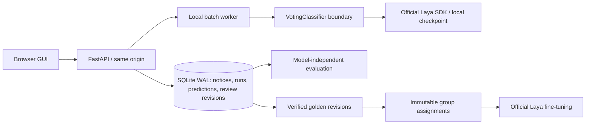

# Laya Corporate Actions Voting Lab

A runnable local application for testing whether **Laya**, a small specialised, non-generative decision model, can classify shareholder voting notices reliably. FastAPI, SQLite and a restrained browser GUI provide source inspection, immutable experiment history, human review, golden labels, group-separated training and evaluation.

**This is an experimental product demonstrator, not a validated voting service.** Its interface reports unknown accuracy as unknown and disables automatic processing by default. Laya remains the primary specialist; an optional real local generative fallback and an explicitly separate LLM-only benchmark are available.

The product scope is the **end-to-end classification and training framework**:
versioned labels → isolated data exports → Laya or local-LLM training → checkpoint
registration → evaluation/calibration → explicit model selection. AI-authored and
AI-reviewed labels are supported for framework development and remain visibly
distinct from human/expert reviews. See the [training framework guide](training/framework/README.md)
and Model Lab. Building and testing this workflow does not require waiting for
expert customer labels; establishing customer accuracy still does.

Latest framework verification: **2,150 software tests and 25 browser tests pass**, with real official Laya and Qwen3.8-27B quantised training/save/reload/API execution qualified separately. [Read the engineering qualification](data/reports/QWEN_TRAINABLE_CHECKPOINT_QUALIFICATION.md). The earlier controlled experiment also recorded13 live local-model integration test passes. The controlled A–E experiment persisted **1,025 predictions** over 205 authored/synthetic records, including 497 actual local LLM invocations. The historical public baseline remains **7,683 unlabelled source-row outputs with zero failed rows**. Authored semantic quality failures remain visible; they are not software-test passes. Automatic processing remains disabled. [Read the controlled evaluation](data/reports/LAYA_LLM_ARCHITECTURE_EVALUATION.md) and [historical public-corpus verification](data/reports/VERIFICATION.md).

Historical supervised research: **supplied synthetic test all-supplied-field exact match 6/100 → 100/100; unchanged semantic challenge cases satisfying supplied partial assertions 30/57 → 37/57.** The fine-tuned model still makes **12 challenge errors with policy score ≥98%**. The supplied test has known duplicate overlap and two previously exposed labels. **Automation remains disabled; no customer accuracy claim is supported.** See [the complete study](data/reports/LAYA_TRAINING_EVALUATION.md) and [every remaining challenge failure](data/reports/LAYA_FINETUNED_CHALLENGE_ERRORS.md).

## Start the application

Requires Python 3.12 and [uv](https://docs.astral.sh/uv/getting-started/installation/). Node is not required for the frontend. Run from this repository:

```bash
./scripts/start.sh
```

Open **http://127.0.0.1:8000**. The command installs locked dependencies and serves the complete application. It starts with an empty workspace on a clean checkout; it does not invent notices or predictions. `PORT=8001 ./scripts/start.sh` selects another port.

To download, profile, import and classify the public corpus on a fresh checkout:

```bash
./scripts/setup_demo.sh
./scripts/start.sh
```

Setup downloads approximately 60 MB of source data and 615 MB of model files. Model inference takes time, depending on hardware. The script prints progress and persists each completed batch. On this development Mac, inference uses MPS; CUDA is preferred where available, otherwise CPU. Use `LAYA_DEVICE=cpu` to override. Classification is resumable after interruption.

With setup data already present, Docker is an alternative:

```bash
docker compose up --build
```

Docker publishes only to loopback, mounts `./data` for persistence, and uses CPU. The image does not bundle customer data or weights. Compose configuration validates, but image builds on this host timed out while fetching registry metadata (both GHCR and a Docker Hub-only retry). Docker startup remains unverified; use the native startup for the verified path.

## The public example corpus

The original request described 15,022 records. **No such dataset was supplied.** At the user's request, this implementation instead sources [TheTokenFactory/SEC financial extraction instructions](https://huggingface.co/datasets/TheTokenFactory/sec-contracts-financial-extraction-instructions), pinned to revision `c90ac749f9056901c8c3ed22ae1ff7c894c9b696`, licensed CC BY 4.0. Credit: TheTokenFactory, underlying SEC filings. Modifications: selection of source `input`, normalisation, provenance mapping, duplicate grouping and splitting. No extraction target is used as a voting label.

The downloaded corpus contains:

| Observation | Count |
|---|---:|
| Source rows | 7,683 |
| Proxy-statement excerpt rows | 1,897 |
| Contract excerpt rows, useful as distractors | 5,786 |
| Distinct normalised texts | 2,931 |
| Filing / duplicate groups | 1,066 |
| Human-verified votability labels supplied by source | 0 |

These are **filing excerpts repeated across extraction tasks**, not 7,683 individual events, complete filings or custodian instructions. They provide a substantial public starter corpus but are **not comprehensive coverage of global corporate-action notices**. Compensation and historical governance are overrepresented. Real operational notices and domain experts remain necessary for customer claims.

The publisher generated extraction targets using Gemma. This application excludes `instruction`, `output`, publisher extraction confidence and extraction task labels from Laya input and from golden labels. Only the original `input` text and fixed reference date enter Laya. Model inference is local; source/model downloading requires internet access but uploads no notice text.

Read [the profile](data/reports/PROFILE.md) and [structured profile](data/reports/profile.json) for field meanings, distributions, unknowns, repeated openings, suspicious encoding, HTML and length checks. Issuer comes from publisher metadata and can be unknown. Missing company displays are completed only from a single consistent company value for the same source filing, with a reference record ID; original metadata remains intact. Country, market, meeting dates and ISIN are not supplied reliably and are not guessed. Language identification is heuristic; short financial tables can be misidentified.

Raw files are unchanged in `data/raw`, excluded from Git. SHA-256 checks verify the pinned releases. Normalised source records are stored separately in `data/normalised/public.jsonl` and SQLite. Source hashes cover the original excerpt, before HTML stripping, NFC normalisation and whitespace collapse.

To reproduce individual setup steps:

```bash
uv sync --frozen
uv run python scripts/source_public_data.py
uv run python -m scripts.profile_data
uv run python -m scripts.import_data data/normalised/public.jsonl
uv run python scripts/download_model.py
uv run python -m scripts.run_batch
```

## Architecture



`apps/web` is an accessible, buildless HTML/CSS/JavaScript frontend. This keeps installation small and gives the API and frontend the same origin. `apps/api` owns persistence and review transactions. `classifier` isolates SDK details behind `VotingClassifier`; evaluation consumes structured results, so future ModernBERT, rules, hybrid or separately enabled LLM experiments can use the same harness. The historical batch path uses Laya. The versioned `semantic_pipeline` additionally supports real local fallback, explicit escalation/reconciliation and a separate independent-LLM benchmark. The research directory also contains a separate local MiniLM encoder/logistic-head benchmark; it is never an application fallback.

SQLite stores immutable source records, run input manifests, one result or explicit error per input/run, and append-only human revisions. Database triggers reject changes/deletions to predictions, reviews, input manifests and run configuration. A failed classification is visible, never replaced by a fabricated result. Run status and measured benchmark fields are the mutable job lifecycle fields. This is an audit ledger, not cryptographically tamper-proof storage against a database administrator.

## Laya model and score handling

Runtime: **official `laya==0.4.8`** from PyPI, pinned with the complete dependency graph in `uv.lock`. [Official implementation](https://github.com/NandhaKishorM/laya), [model family](https://huggingface.co/convaiinnovations/laya).

Checkpoint: `convaiinnovations/laya`, `multilingual` subfolder, revision `7b928d828b7b0e022f929d9bd2e44165aa270148`. This is the approximately 322M parameter mmBERT-backed Laya model. We use a single multilingual checkpoint for reproducible coverage rather than routing across checkpoints. Downloaded weights must match SHA-256 `9d628fd971b700382ac6f65920a86f149777b2e748e0c955fb3b19695aa8f204`. Setup writes a file integrity manifest; subsequent loads verify it. The SDK may make a local tokenizer compatibility repair; weights are unchanged.

Laya receives five typed `choice` questions in one `predict_batch` call per group of source texts. It returns choices and **native option probabilities** for each factor. The adapter:

- Preserves each native factor distribution and the raw SDK answer, including entropy confidence and `answer_confidence`.
- Uses the **minimum winning option probability** across the five factors as a conservative **policy score**. This is explicitly **not a probability of the derived status**. No seven-way probability distribution is fabricated; the GUI shows factor bars.
- Does not use the SDK action head as an automation signal.
- Validates finite values, bounds, score labels and sums, allowing only the SDK's four-decimal rounding error. It does not renormalise rounded values.
- Records SDK version, checkpoint revision, configuration hash, latency, token usage and truncation.
- Escalates truncated input, option-budget warnings, uncertain restrictions, ambiguous votes, conflicting factors and an actionable vote with an unknown deadline.

The baseline uses a 2,048-token input budget and 256-token head budget. This does **not guarantee complete model coverage of every long excerpt**; the SDK reports dropped tokens and affected questions, and these records require review. The original complete excerpt is always displayed. Increasing `max_len` up to 8,192 is configurable but needs a new run and measured validation. Long inputs do not silently disappear.

Laya's published limitations include raw calibration, option wording/order sensitivity and imperfect zero-shot domain performance. The actual semantic challenge report is retained even when expectations fail. A base model's advertised benchmark is not evidence of voting accuracy.

## Taxonomy and deadlines

[The explicit configuration](classifier/config.json) versions instructions, criteria, model/context budgets, fixed evaluation date and thresholds. The initial schema is provisionally factorised:

```text
votable: YES | NO | UNCERTAIN
share_blocking / poa_required / other_restriction: true | false | null
  false means “no current requirement stated or explicitly waived”
  null means “ambiguous or conflicting”
deadline_status: OPEN | PASSED | UNKNOWN
manual_review_required: bool
```

Seven statuses are derived with documented precedence: uncertain voting opportunity → not votable → passed deadline → unknown restrictions → multiple/other restrictions → POA only → blocking only → votable. All factors remain visible even when a higher-priority status wins. Overlap is therefore retained. Public excerpt data does not justify mutually exclusive restriction classes. Business owners must validate both this schema and the meaning of “not stated”.

The preserved v1 baseline asks Laya for deadline status. A separate research configuration, `classifier/config-factorised-v2.json`, asks Laya only about deadline presence and uses the versioned conservative parser in `classifier/deadlines.py` for extraction/comparison. It abstains on unsupported formats, unresolved conflicts and same-day comparisons without sufficient timestamp information. This ablation is separate from the supplied-label training study; neither silently changes the historical baseline. In v1, Instructions distinguish controlling custodian deadlines from issuer deadlines, record dates, meeting dates and quoted history. The reference date is **2026-10-16**, injected into inference and static regression cases. Same-day cutoffs without sufficient reference time/timezone are unknown. Changing the reference date creates a different configuration and experiment. Golden revisions retain the review's date context.

## Run, reproduce and export

```bash
uv run python -m scripts.run_batch
uv run python -m scripts.run_batch --limit 8
uv run python -m scripts.run_batch --resume RUN_ID
uv run python -m scripts.run_batch --reproduce RUN_ID
uv run python -m scripts.verify_run --run RUN_ID --output artifacts/verification-UNIQUE.json
uv run python -m evaluation.evaluate --run RUN_ID --split test --output artifacts/evaluation-UNIQUE.json
```

Every run gets a new UUID, source input hashes, ordered input membership, dataset/configuration hashes, model version, reference date, explicit question/option order, timestamps and source-code fingerprint. New runs also retain a Python source/config/lock archive in `data/run_sources`. Reproduce uses the original input membership and configuration. **For exact code reproduction, restore that run's archived code and locked environment in a separate checkout.** The current source fingerprint is always recorded; running a new code version with old inputs is not evidence of bit-identical reproduction. Different hardware or kernel versions can change floating-point results. The verification script checks output/input counts, errors, all result scores, source hashes, versions and split assignments.

Exact normalised texts are inferred once per run, then their result is associated with every original row. Cache reuse records its original inference source record. Measured **source-row throughput includes this reuse**; distinct-text throughput is reported separately. Per-record inference latency is **amortised batch latency**, not online request response time. Median/p95, total wall time, load time, device and sampled process RSS are retained. RSS does not include every GPU allocation. A resumed run reports the session's timing, not an invented total across process interruptions.

The GUI supports run inspection and reproduction. A job interrupted by server termination remains visible; use the CLI resume command after checking no worker is active. Errors are retained rather than edited away; rerun in a new experiment to retry failed records. Local server restart retains SQLite state. Do not run multiple API workers for this PoC's in-process batch queue.

Download JSONL exports in the GUI or use:

```bash
curl 'http://127.0.0.1:8000/api/export?kind=results' -o results.jsonl
curl 'http://127.0.0.1:8000/api/export?kind=golden' -o golden.jsonl
curl 'http://127.0.0.1:8000/api/export?kind=audit' -o audit.jsonl
curl 'http://127.0.0.1:8000/api/export?kind=evaluation' -o evaluation.jsonl
```

## Human review and golden data

Open a notice in the explorer or review queue. Read the complete source, choose verified factors, enter a reviewer identity and confirm/correct. Flagging is separate from verification. Corrections append a new revision; optimistic revision checks reject overwriting another review. The ledger stores original text by reference, source hash, reviewer, timestamp, factor label, date context, previous prediction, exact-factor correctness and notes. Exports include the text and revision history. No authored challenge case is silently promoted to the golden dataset.

Notice detail includes a **Why?** summary of source metadata, native Laya factor assessments and literal registration-related excerpts. Each item identifies its basis. It does not invent ISO15022 fields or treat model-only deadline predictions as verified calendar comparisons. Blind review hides the prediction and its summary. The summary is a versioned display artifact; historical predictions and frozen model criteria are unchanged.

Reviewers can see predictions; this can bias labels. A defensible study should introduce blind first review, expert adjudication, reviewer agreement measurement and a frozen test set. The current GUI identity field is an audit attribution field, not authentication.

## Training and independent evaluation

```bash
uv run python -m training.dataset artifacts/golden-v1
uv run python -m training.train artifacts/golden-v1 data/models/laya-voting-v1 --dry-run
uv run python -m training.train artifacts/golden-v1 data/models/laya-voting-v1 --epochs 4
uv run python -m scripts.run_batch --config data/models/laya-voting-v1/voting-config.json
uv run python -m evaluation.evaluate --run NEW_RUN_ID --split test --output artifacts/finetuned-test-v1.json
```

The pipeline exports only latest verified revisions, retains their source hashes and revisions, rejects conflicting duplicate labels, and separates train/validation/test files. Training refuses fewer than 20 distinct reviewed training inputs and 10 validation inputs; these are smoke-test minimums, not evidence of statistical sufficiency. No training has been claimed on unreviewed public data.

Duplicate grouping uses a complete exact Jaccard threshold join of normalised five-word shingles at 0.85. Global-frequency prefix filtering reduces candidate work without sacrificing recall under this metric; integer comparisons avoid boundary rounding. Numeric masking groups templates conservatively. Transitive matches and all excerpts of the same filing are united. A stable group hash assigns approximately 60/20/20% to train/validation/test. Record proportions may differ. This is deterministic group allocation, **not label-stratified splitting**: there are initially no trustworthy category labels, and country/market are unknown. The profile exposes available split/type/language distributions. An independent exact audit found two cross-split pairs missed by the initial LSH protocol. Grouping was corrected before any human labels or training existed. The final exact audit reports zero cross-split matches at 0.85. Semantic paraphrases below that threshold still require human audit. Original profiles, audit failures and the pre-correction database are retained; model inputs and predictions remain byte-for-byte unchanged because split assignment is not an inference input.

Corpus membership freezes after import and certainly after the first review. A changed corpus requires a new database and regrouping; prior reviewed split assignments are never moved. The fine-tuning wrapper invokes official `laya.train.finetune`, freezing the encoder by default and training the decision head with soft cross entropy. It verifies export file checksums and question/option order, disables the SDK's question-level internal calibration split and fits native temperatures on the group-separated validation file after optimisation. Test data is never passed into training or calibration. Output directories cannot overwrite a previous model. A trained model receives its own weight hash and inference configuration, with automation still disabled.

Evaluation reports overall/balanced accuracy; per-status precision, recall, F1 and support; macro/weighted F1; a confusion matrix; current-votable recall; factor metrics; all-factor exact match; native-factor Brier/log loss/ECE; policy-score calibration diagnostics; automation curves; and operational auto/manual/wrong-auto outcomes. Errors group by prediction, truth, geography, language, document type, length and score range; high-score errors have a separate view. Repeated three-word phrases are observations, not invented causal explanations.

**Threshold selection uses validation only.** A candidate for 98% precision must have at least 100 distinct source groups and a 95% Wilson lower confidence bound of at least 98%. A group's prediction counts as correct only when all selected decisions in that group match every verified factor. The curve also shows row counts and observed exact-decision accuracy. This conservative check still does not establish out-of-distribution safety. Validation supports temperature fitting and policy exploration; larger studies should reserve another policy-selection partition. Test curves are diagnostic and must not choose the policy. The GUI does not automatically enable an exploratory policy.

## Tests and browser verification

```bash
uv sync --frozen --group dev
uv run pytest tests/unit tests/integration tests/classifier -q
RUN_E2E=1 uv run pytest tests/e2e -q
uv run python -m scripts.semantic_benchmark artifacts/semantic-UNIQUE.json
RUN_MODEL_TESTS=1 uv run pytest tests/classifier -q
```

The first suite covers deterministic application contracts; real-model challenges are explicitly opt-in. `RUN_MODEL_TESTS=1` asserts the semantic expectations against actual local Laya and **may fail**. Those failures are scientific findings, not application test failures to conceal. The semantic benchmark writes every expectation, observed factor, actual score and pass/fail to a new artifact without changing golden labels. Its 57 authored cases include AGMs/EGMs, schemes, proxy voting, POAs, blocking, eligibility, overlapping restrictions, negation/double negation, historic quotes, deadline precedence, multiple dates, same-day time uncertainty, mandatory/voluntary events, Unicode/HTML, adversarial instructions, German, French and Spanish. These are specifications, not independent customer labels.

Browser tests use Python Playwright and installed Chrome on macOS; elsewhere install Chromium with `uv run playwright install chromium`. They start an isolated server on a free port and a snapshot of the public database. Automated reviewer corrections never enter the demo's golden data. Browser batch/reproduction tests use an explicitly named **test double** inside the test-only server; separate real local inference and full-corpus runs verify the actual model. Screenshots are saved to `artifacts/overview.png`, `notice-detail.png`, `performance.png` and `methodology.png`. They are smoke artifacts, not cross-platform pixel baselines. The in-app browser connector failed during this session, so standalone Playwright supplied the verified browser path.

## Demo flow

1. Open Overview: actual analysed row count, zero enabled automation, unknown verified accuracy.
2. Open a public proxy excerpt: inspect original text, provenance, Laya factors, native scores, context truncation and fixed reference date.
3. Open a low-score or conflicting case in Review queue. Explain the escalation reason.
4. Confirm/correct **only if a real reviewer can verify the content**; enter identity and rationale.
5. Open Model performance: distinguish test from validation, inspect support and errors, and export the evidence.
6. Open Model runs & audit to show versions, source fingerprints and measured throughput.

Demo mode hides technical hash details but preserves uncertainty and provenance. It never replaces real results with curated marketing numbers. Synthetic regression and E2E data are not presented as customer evidence.

## Importing a future customer dataset

First inspect the source schema and document the record unit. Do not infer column meanings from names alone. Preserve source files separately, create a new database via `VOTING_DB=data/customer-v1.sqlite`, and adapt the profiling importer to an explicit, reviewed field mapping. The included `scripts/profile_data.py` is deliberately specific to the documented public format, rather than a silent generic column guesser. The normalised JSONL importer expects `id`, original `text`, `source_hash`, `group_id`, `split` and provenance metadata; it rechecks grouping/isolation and rejects changed corpus membership. Run profiling and duplicate grouping before any labelling or training. An arbitrary original customer file cannot be dropped into the current public-format importer without mapping it.

## What this PoC proves — and what it does not

It demonstrates a local non-generative Laya integration, a usable operations interface, reproducible inference records, review revisions, measured execution, and a framework for testing the central hypothesis against verified independent data. It also exposes zero-shot errors rather than manufacturing confidence or labels.

It does **not** establish voting accuracy without domain-expert labels, a safe automation percentage without validation support, comprehensive global market/language coverage, robust deadline reasoning, or production readiness. It does not claim 15,022 notices, fabricate a seven-class probability distribution, or report a publisher extraction score as voting confidence. Exact shingle checks cannot prove all semantic leakage absent. It lacks enterprise authentication/RBAC, durable distributed job scheduling, adjudication/blinded labelling, full regulatory controls, operational monitoring and disaster recovery. Bind it to localhost for demonstration, as the default scripts do.

Legacy runs created before explicit question/option ordering are retained for audit and superseded by the ordered baseline. The application refuses to reproduce those legacy configurations: JSON key sorting changed option order without changing the original hash. Regression tests now check this failure mode. The failed original reproduction is preserved alongside the successful ordered reproduction.

For an exact archived-source replay of an **ordered** run in a separate directory (replace the paths and ID):

```bash
mkdir /tmp/laya-replay
cd /tmp/laya-replay
tar -xzf /absolute/path/to/proxy-voting/data/run_sources/RUN_ID.tar.gz
ln -s /absolute/path/to/proxy-voting/data data
uv sync --frozen
uv run python -m scripts.run_batch --reproduce RUN_ID
```

This creates a new run in the shared ledger while preserving the original. Never run replay commands against a database receiving a different corpus import.


## Supplied synthetic supervised study

The supplied ZIP at `data/training/laya_voting_synthetic_500.zip` contains 300 training,
100 validation and 100 test examples. Its README explicitly identifies these as synthetic,
not expert-labelled production data. See [the research report](data/reports/LAYA_TRAINING_EVALUATION.md)
and [all 27 original failures](data/reports/LAYA_BASELINE_FAILURE_ANALYSIS.md).

Important limitations: 37 exact / 40 near-duplicate groups cross the supplied splits;
37 test rows overlap training and 42 overlap training or validation. The exact supplied
memberships were retained on explicit instruction. The all-500 JSONL was opened/read by the initial inspection script before the explicit
blind protocol; only two test labels (SYN-0001/0002) were printed in tool output. No
other rows from that file were used for fitting or selection. The report discloses that exposure
and a 98-case sensitivity result. No claim of fully independent or wholly unseen test
labels is made. Synthetic test results cannot enable automation or support customer accuracy.
The supplied customer-status precedence and OPEN definition differ from the original
application/challenge definitions; both are explicit and reported separately.

Fresh experiment, in order (requires the unchanged supplied ZIP):

```bash
# Use a new identifier to retain all previous runs/checkpoints.
export LAYA_SYNTHETIC_EXPERIMENT=data/experiments/supplied-synthetic-v2
uv run python -m training.synthetic_protocol prepare
uv run python -m training.synthetic_protocol train --device mps
uv run python -m training.learning_curve --device mps --candidate head-4ep
# Optional conventional encoder benchmark, still before any test answer-key access:
uv run python -m scripts.download_encoder_baseline
uv run python -m training.encoder_baseline train
# Freeze weights, criteria, preprocessing, dependency hashes and thresholds:
uv run python -m training.synthetic_protocol freeze
uv run python -m training.synthetic_protocol blind
uv run python -m training.encoder_baseline blind
# Both Laya blind predictions and reload checks now exist; only now read test answers:
uv run python -m training.synthetic_protocol score
uv run python -m training.encoder_baseline score
uv run python -m evaluation.post_synthetic
uv run python -m scripts.semantic_benchmark "$LAYA_SYNTHETIC_EXPERIMENT/base-challenge.json"
# Read selected.model_config from validation-selection.json for the next command:
uv run python -m scripts.semantic_benchmark "$LAYA_SYNTHETIC_EXPERIMENT/fine-tuned-challenge.json" --config SELECTED_MODEL_CONFIG
uv run python -m evaluation.encoder_challenge
uv run python -m scripts.plot_experiment
uv run python -m scripts.report_training
```

Choose `--device cpu` when MPS is unavailable (CUDA is also supported by the SDK).
All output paths refuse overwrites. Train/tune readers whitelist only the supplied
training/validation CSVs; neither the labelled test CSV, answer key nor all-500 files
can enter those readers. The explicit synthetic leakage exception verifies source IDs,
hashes, text and targets; normal golden training retains strict isolation. Existing
semantic challenge IDs/text hashes are blocked from training. The historical
`synthetic-smoke-v1` challenge-trained mechanics checkpoint is excluded from this study;
its old script is retired.

`FREEZE.json` hashes the selected checkpoint, source and criterion/configuration files.
`BLIND-COMMIT.json` commits both 100-row prediction files before scoring. Each frozen
checkpoint is reloaded and its full blind predictions compared on native scores,
factors, statuses and policy score; latency is excluded from equality. Never retune a
model using scored test answers and then reuse that test as independent evidence.

The learning curve uses nested 50/100/200/300-row subsets of the supplied training CSV,
with one fixed validation set, seed and four-epoch decision-head training schedule.
It is specifically a head-only learning curve; it must not be described as the selected
full-encoder candidate's curve. Sizes 400/800 are unavailable without more training data.
Figures and all matrices/failures are retained under the experiment directory.

The separate real-public-data cohort is in `data/studies/laya-supervised-v1/`: 1,000
selected records in 1,000 filing/duplicate groups, split 600/200/200. Its hashed membership
is frozen in SQLite. The review queue selects that cohort and hides AI predictions
while reviewing. Reviewer expertise and blindness are attestations, not authenticated
proof; expert adjudication and agreement measurement remain necessary. No synthetic
labels are added to human review history. After genuine test reviews, pin their exact
revisions with `training.study.lock_test_labels()`. Later review corrections remain in
the ledger but do not silently replace pinned test truth. A new test-label edition needs
a new study and explicit disclosure.

Proposed research quality gates are configurable in `evaluation/quality_gates.json`.
They require independent expert evidence and sufficient positive/group support, not
just improved synthetic accuracy. The performance page always shows the gate status
and reasons, including in demo mode; passing a report does not activate automation.

Historical research verification before the ISO phase: 145 deterministic application checks and nine browser tests passed.
Real-model pytest deliberately retains failures: base Laya 30/57, selected fine-tuned
Laya 37/57; together 47 failing semantic cases across the two models. Reproduce both:

```bash
RUN_MODEL_TESTS=1 RUN_FINETUNED_MODEL_TESTS=1 uv run pytest tests/classifier -q
```

These are unchanged quality specifications. A green application suite does not imply
a green semantic suite. The customer demonstration remains a research PoC.


## Evidence links and stage-specific metrics

Every “Why?” item links to its supporting metadata, exact source passage, native
model factor/criteria, deadline comparison or processing record. Literal source
links preserve Unicode codepoint offsets and highlight the complete original
passage without leaving the record. A model-score link substantiates the model
assessment; it is not a generated causal explanation. Blind review hides both the
prediction and its evidence summary.

Overview and Model performance show **Parser accuracy**, **Semantic-model accuracy**
and **End-to-end decision accuracy** separately, including definitions, reference
support and denominators. `GET /api/metric-layers` exports that separation for the
selected run. Missing independent reference labels display “Not measured”. Existing
factor-derived status agreement is not promoted to independent final-event accuracy,
and synthetic experiments remain separate. The filing-excerpt corpus contains no usable ISO15022 structure. A separate generated
partial-message parser corpus is evaluated independently below.

The implemented subset and public-source limitations are documented in
[data/reports/ISO15022_PROXY_RESEARCH.md](data/reports/ISO15022_PROXY_RESEARCH.md).


## Standards-aware hybrid experiment

Read [ISO15022_HYBRID_EVALUATION.md](data/reports/ISO15022_HYBRID_EVALUATION.md)
and [all hybrid challenge failures](data/reports/ISO15022_HYBRID_ERRORS.md).
The preserved whole-text modes pass 30/57 (base) and 37/57 (fine-tuned); the new
parser/rules/narrow-Laya modes pass 26/57 and 32/57. The 57 authored notices have no
ISO fields, so these results do not establish a parsing benefit. Automation is off.

`hybrid/` contains a lossless experimental ISO15022 subset parser, routing trace,
native narrow Laya predicates, passage aggregation/evidence, explicit decision rules,
disabled semantic fallback and an append-only SQLite event ledger in that historical namespace. The complete real local fallback is in `semantic_pipeline/` (see below). No cloud LLM is
used. MT564/565/567/568 fields are read within the documented subset; MT566 is opaque
confirmation history. This is not a FIN conformance validator: all structured fixtures
remain PARTIAL, and unsupported data remains visible. Date-only/local cutoffs never
silently become UTC. Current sender service acceptance is separate from message grammar.

The separate corpus has 1,100 standards-derived **partial** fixtures, 500 mutations,
one short official disclosure-example excerpt, and zero production messages. Its
`sources.jsonl` commits provenance and hashes; `research_sources.json` records source
research, version and licensing limits. It never supplies semantic training labels.
All 7,683 existing public excerpts were parsed without crashes: 7,674 unstructured,
nine unrecognised, zero usable ISO tags. No deterministic decision facts were resolved.

A new checkpoint in `data/models/narrow-v1` trains only voting opportunity, blocking
and POA from the supplied 300-row train CSV. The 100-row validation CSV alone supplies
temperature fitting. Other new predicates lack compatible training labels; they are
transfer experiments. Its files/configuration/seed/source hashes/losses are under
`data/experiments/narrow-v1`. The earlier frozen blind test was not reused for this
new study. The labels remain AI-synthetic, and known supplied split leakage limits
interpretation. No new independent expert test or narrow-task learning curve exists.

The performance page exposes the architecture comparison, source corpus examples,
routing trace, source-exact evidence candidates, error explorer and a clearly labelled
synthetic event-history demonstration. Every semantic quotation matches source text;
quotation correctness does not prove semantic support. Missing evidence is explicit.
Event history retains old and current deadlines and all raw messages. Complex narrative
supersession and complete sender/account profile semantics still require review.
Public accuracy cards remain unmeasured because independent expert labels are absent.

Run the additional checks after normal setup:

```bash
uv pip install --python .venv/bin/python -r requirements-hybrid.txt
.venv/bin/python -m pytest -m 'not model and not e2e and not local_llm' -q
RUN_E2E=1 .venv/bin/python -m pytest tests/e2e -q
.venv/bin/python -m scripts.verify_iso
```

Hypothesis is separately pinned so the historical frozen `uv.lock` remains unchanged.
`uv sync` may remove the extra property-test dependency; reinstall it before these tests.
The actual model-quality failures remain in the separate opt-in semantic tests above;
a passing application suite never implies a passing semantic suite.

Reproduce into a **new destination**, preserving every historical run:

```bash
# Reuse frozen weights, rerun base/fine challenge + validation/pairs and corpus audits:
.venv/bin/python -m scripts.reproduce_hybrid /tmp/laya-hybrid-reproduction --reuse-checkpoint
# Or retrain the three-target checkpoint from the exact supplied TRAIN/VALIDATION files:
.venv/bin/python -m scripts.reproduce_hybrid /tmp/laya-hybrid-retraining
```

Both require the downloaded local base weights and original supplied ZIP. Add
`--prepare-only` to inspect the command plan before running. Existing destinations
are rejected; logs and reports remain under that destination. These commands open
no original synthetic answer-key/test-labelled file. The original prior blind study
remains separately reproducible through its existing documented protocol.


Latest hybrid verification includes a fresh-directory reproduction: both models'
57 challenge and 100 validation native outputs are identical. Application/browser
check counts and remaining semantic failures are recorded in the hybrid report.
The live service adds an unknown-CAEV guard without changing the frozen benchmark.

## Real local LLM and controlled A–E study

The complete semantic route is implemented separately in `semantic_pipeline/`; the historical frozen `classifier/` and `hybrid/` remain benchmarkable. It uses a real local Ollama generator, not the earlier `DisabledFallback` stub. See [model selection](data/reports/LOCAL_LLM_SELECTION.md) and [controlled evaluation](data/reports/LAYA_LLM_ARCHITECTURE_EVALUATION.md).

The initial checkpoint is `glm-4.7-flash:latest`, **Q4_K_M**, exact Ollama manifest `d1a8a26252f18b34301218d22abd2620a65b85ba4b78987842eb157e01321222`, Ollama **0.34.3**, on Apple Metal. The tag and runtime are verified before each call. A different digest/version requires a new experiment/configuration, not silent substitution. These weights were already installed; this phase downloads no model. The client accepts literal loopback addresses only, disables proxy/redirect handling and has no hosted inference path.

Normal operation defaults to `LLM_ENABLED=false`. To allow explicit local semantic analyses, start with `LLM_ENABLED=true ./scripts/start.sh` after the pinned Ollama model/runtime is available. This enables model calls, **not automation**. POST `/api/semantic/analyse` with `{"text":"...","architecture":"E"}` runs the complete optional-parser / narrow-Laya / fallback / reconciliation / rules path and persists an append-only audit record under `data/semantic-runs/`. A/B remain frozen historical whole-text routes; C uses whole-text fine-tuned Laya with fallback; D uses the generator independently. No model gets expected labels. Large inputs that cannot fit the explicit context budget abstain; they are never silently truncated into LLM requests.

The Model Performance page adds the controlled comparison and a source-linked stage-provenance/error view. Exact API evidence includes both model outputs, escalation reasons, original scores, validated quotes, conflicts, rules and final status. No LLM probability is invented. A source-exact quotation is provenance, not proof of correct interpretation.

The staged experiment commands are:

```sh
# Use a NEW directory for another run. Existing files cannot be overwritten.
export LAYA_AE_EXPERIMENT=data/experiments/local-llm-v2
.venv/bin/python -m semantic_pipeline.experiment prepare
.venv/bin/python -m scripts.snapshot_local_llm_runtime
.venv/bin/python -m semantic_pipeline.experiment validate
.venv/bin/python -m semantic_pipeline.experiment freeze
.venv/bin/python -m semantic_pipeline.experiment evaluate
.venv/bin/python -m scripts.score_local_llm_run --oracle  # saves EVALUATION.md inside this NEW run
.venv/bin/python -m scripts.verify_local_llm_experiment
.venv/bin/python -m semantic_pipeline.experiment verify
```

Validation uses 40 unique, deterministically stratified examples from the supplied validation CSV; no challenge/test tuning. Actual counterfactual fallback calls enable the threshold sweep. Independent and fallback prompts are separate. The code, criteria, prompt/schema, routing, reconciliation and checkpoint hashes freeze before test inference. Completed record prefixes can resume, with input-ID checks and one persisted run ID. Scoring checks all prediction commits before opening the historical answer key. For scored `v1`, use only `verify` and read its immutable artifacts; use a new directory for reproduction. The scoring wrapper keeps each new report inside its own experiment directory and preserves its original frozen-scorer report. The v1 customer-facing summary remains under `data/reports/`.

Evaluation sources stay separate: **57 frozen authored cases with partial assertions**, the **100 previously exposed, duplicate-contaminated synthetic examples (NOT BLIND / DEVELOPMENT ONLY)**, and **48 newly authored fully labelled synthetic benchmark cases**, including eight standards-derived partial messages. Unlabelled predicates never count as correct; unsupported capabilities count as failures. Parser tests, raw semantic agreement and end-to-end status agreement have separate denominators. These sources establish no customer accuracy. All decisions still require human review.

Additional real-model verification (requires the pinned local runtime/checkpoints): Reinstall `requirements-hybrid.txt` after any `uv sync`, as described above.

```sh
RUN_LOCAL_LLM=1 .venv/bin/python -m pytest tests/classifier/test_real_local_llm.py -q
RUN_E2E=1 .venv/bin/python -m pytest tests/e2e -q
.venv/bin/python -m pytest -m 'not model and not e2e and not local_llm' -q
```

The ordinary suite includes explicit test doubles for software contracts; those tests are never described as real-LLM evaluation. The opt-in generator and complete-path tests execute actual local models. Historical authored semantic failures remain visible and their expected labels are unchanged.


### Configured application path and Decision Trace

`CLASSIFICATION_ARCHITECTURE` selects `LEGACY_LAYA` (default), `FT_LAYA`, `LAYA_LLM`, `LLM_ONLY`, or `FULL_HYBRID`. `LLM_ENABLED=false` and automation disabled remain defaults. To explicitly exercise the local fallback application path:

```sh
LLM_ENABLED=true CLASSIFICATION_ARCHITECTURE=LAYA_LLM ./scripts/start.sh
```

Open a Notice Detail and use **Analyse notice with configured architecture**. The source is read from the persisted notice, a separate execution is saved, and the expandable **Decision Trace** shows both models, escalation, evidence, reconciliation, deadline/rules and review reasons. Reading/refreshing the trace never runs a model. Blind expert review hides it. Existing baseline batch jobs keep their original whole-text implementation; this flag controls the explicit per-notice action, not silent replacement of old batch history.

`POST /api/semantic/analyse` accepts `{"record_id":"..."}` to use that configured architecture; an explicit A–E `architecture` overrides it for a local experiment. Text-only requests remain supported. Source text supplied with an existing record ID must match the saved source exactly. Every execution remains append-only and readable after restart. No new analysis becomes a golden label automatically.

**Model Lab · internal** compares saved A–E outputs for the same notice/ground truth, highlights failed assertions, exposes each recorded trace, and reports LLM calls, semantic repairs/damage, schema failures and recorded latency. Its metrics are research results; customer accuracy remains unknown.

`LLM_SCHEMA_REPAIR=true` optionally permits one bounded schema repair in this application path. It is disabled by default, preserves both attempts and a distinct prompt hash, never retries runtime/context/truncation failures, and was **not used in the frozen A–E experiment** (497/497 first-pass schema-valid outputs). No retry changes those historical results.

### Extended diagnostics

The main [30-question report](data/reports/LAYA_LLM_ARCHITECTURE_EVALUATION.md) links the [11-case blocking investigation](data/reports/BLOCKING_FALSE_NEGATIVE_ANALYSIS.md) and [every A–E assertion failure](data/reports/ARCHITECTURE_COMPARISON_ERRORS.md). The study directory includes per-predicate oracle/disagreement/asymmetric-error metrics, 15 run manifests, validation-only routing strategies, 20×3 repeatability calls, warm latency/token statistics and actual Mac process/unified-memory samples. Post-study diagnostics never change the frozen operating points. Exact native scores are not calibrated correctness probabilities.

```sh
# Small intentional REAL local-model suite (13 tests, ~87 seconds on this Mac)
RUN_LOCAL_LLM=1 .venv/bin/python -m pytest -m local_llm -q
```

The original authored semantic ML regressions still fail 27 base / 20 fine-tuned cases under unchanged assertions. These failures remain separate from the passing software/browser suites. The in-app Browser connection was unavailable during final verification; the complete Playwright browser suite was executed successfully, with screenshots in `artifacts/`.

## Aggregation / Qwen / selective-cascade phase (in progress)

The pre-fix system is preserved under git tag **PRE_AGGREGATION_FIX_BASELINE** and [its manifest](data/experiments/cascade-v2/PRE_AGGREGATION_FIX_BASELINE.json). Historical challenge assertion counts remain A59/B73/C85/D58/E71 out of 95. No Laya checkpoint was retrained and the 57 challenge inputs/assertions remain unchanged.

The evidence-aware reducer corrects the supplied synthetic validation blocking result **0/11 → 11/11 using identical weights**. It retains native passage states/scores/offsets, distinguishes absence from explicit negation, scopes history/background, resolves explicit later supersession, and abstains on unresolved contradictions or an unspecified voting route. Read [aggregation validation](data/reports/AGGREGATION_VALIDATION.md) and [historical C gain decomposition](data/reports/C_GAIN_DECOMPOSITION.md). Six expanded specialist predicates remain transfer-only, with important failures still visible; this is not a customer-accuracy claim.

The new controlled study is asynchronous and computationally substantial. Its current operational status is [LIVE-STATUS.json](data/experiments/cascade-v2/LIVE-STATUS.json); detailed progress is in `artifacts/cascade-phase.log` and **Model Lab → Aggregation & selective cascade · v2**. No new challenge comparison or primary-model claim should be inferred until the relevant frozen evaluation artifacts exist. Final completion requires `FINAL-VERIFICATION.json` and a COMPLETE status, not merely a generated JSON answer.

The real local model conditions are GLM-4.7-Flash Direct, **Qwen3.8-27B Direct**, and **Qwen3.8-27B explicit xhigh Thinking**, all with `proxy_semantic_common_v1`, the same schema and exact-evidence verifier. Qwen library quantisation `qwen3.8:27b-q4_K_M` is pinned to digest `25b843619e944cd0ae6069f94ff4e5e26a16e109ccbc0a66a0f05979ed70098e`; the manifest and installed blobs were verified. See [runtime research](data/reports/QWEN38_RUNTIME_RESEARCH.md). Thinking is mandatory, with a 16,384-token output cap and 32,768 context. It is not shortened to match Direct latency. Hidden reasoning and unvalidated free-form prose are never persisted/displayed; only structured output and permitted count/hash/timing diagnostics remain.

All timed conditions use one request at a time: this Ollama version serialises qwen35 inference. The two-request xhigh pilot took 568 seconds total; native generation durations were 218 and 335 seconds. Those queued preflight latencies are excluded from sequential benchmark comparisons. Expect the full quality experiment to take many hours on this Mac; do not substitute projected numbers for measured results.

The runner performs, in order: 40 complete synthetic validation notices × six independent/always-fallback conditions; repeatability; validation-only primary selection; 80 complete routing-validation notices; an interpretable routing sweep; final freeze; unchanged A/B and common C1–C3/D1–D3 evaluations on the 57 challenge and 48 complete synthetic cases; selected C/E cascades; oracle/disagreement/repair/damage/error reports; regression/real-model tests and a source archive. The old exposed/leaky 100-row synthetic test remains historical development evidence. No new training or two-LLM production ensemble is introduced.

```sh
# Resume missing work; an active-runner lock prevents a duplicate study.
# Installed pinned models/checkpoints are required. This starts only the isolated runtime if absent.
.venv/bin/python -u -m scripts.run_cascade_phase

# Read-only status and progress
cat data/experiments/cascade-v2/LIVE-STATUS.json
tail -n 20 artifacts/cascade-phase.log

# Ordinary software/browser checks
.venv/bin/python -m pytest -m 'not model and not e2e and not local_llm and not qwen_local' -q
RUN_E2E=1 .venv/bin/python -m pytest tests/e2e -q

# Intentional REAL Qwen Direct/xhigh tests (slow; separate from ordinary CI)
RUN_QWEN_LOCAL=1 .venv/bin/python -m pytest -m qwen_local -q
```

The isolated model runtime uses 127.0.0.1:11435 and preserves the normal Ollama service. An idle-sleep guard is limited to the study runner's lifetime. Operational status files can change; raw predictions, freeze manifests and earlier results are append-only/preserved. Every model comparison receives identical applicable inputs and truth; no challenge/test results select a model, prompt or route.

After the selected cascade is frozen, explicit `SEMANTIC_PIPELINE_VERSION=v2` with `CLASSIFICATION_ARCHITECTURE=LAYA_LLM` or `FULL_HYBRID` enables its existing Notice Detail analysis action. **Defaults remain v1, LLM disabled, automation disabled.** Existing whole-text batch history is retained. The v2 application bridge accepts structured parsing only for recognised VALID/PARTIAL messages; ISO-like fragments inside ordinary notices retain the full semantic source. A read-only dispatch scan found **NOT_APPLICABLE for all 7,683 public excerpts**.

On completion the runner produces `AGGREGATION_SELECTIVE_CASCADE_EVALUATION.md`, `GLM_VS_QWEN_DISAGREEMENTS.md`, `GLM_QWEN_MODEL_SELECTION.md`, `QWEN_THINKING_REPAIR_DAMAGE.md`, every assertion failure, full per-field confusion matrices, THREE_MODEL_ORACLE/TWO_LLM_ORACLE/ORACLE_ROUTING, and PNG/SVG validation coverage plots. No primary fallback is selected merely because a model loaded. “Not sent to LLM” and indecisive fast paths are separated from actual automation; every result remains subject to human review.

The browser persistence regression now searches by the unique record ID and waits for the filtered row, replacing an ambiguous issuer/500ms timing assumption. Its persistence assertions are retained. No challenge expectation or failing model-quality test was deleted or weakened.

The routing comparison also has an always-fallback quality control using the **same capable specialist** as the selected cascade. Existing identical-context invoked outputs are reused; every accepted case gets a fallback output irrespective of its expected label. This prevents attributing a specialist-composition change to routing. Its mixed/recomposed durations are excluded from independent latency benchmarks. The control protocol was declared before new challenge inference, and its outputs receive a separate hash commit.

## Qwen domain optimisation and constrained decoding

The new, separate study is `data/experiments/qwen-domain-v1`. Its historical Direct baseline is frozen in `QWEN_DIRECT_PRE_DOMAIN_TRAINING.json`; the57-case partial-assertion challenge is unchanged. No Qwen adapter has yet been trained. Numerical confidence remains null until independent support/calibration gates pass. Automation remains disabled and customer accuracy unknown.

The5,760-text fact-first synthetic corpus is documented in [data/domain-corpus/README.md](data/domain-corpus/README.md). It has six protected roles, group-isolated calibration fit/evaluation, exact/lexical/semantic duplicate checks, and known shared-atom/foreign-language limitations. It is not expert-labelled production data. Three separately attributed public explicit snippets seed a partial-label audit set; they cannot establish real-world performance.

```sh
# Freeze once, then run/resume one local model runtime at a time.
.venv/bin/python -m qwen_domain.study freeze
.venv/bin/python -m scripts.run_qwen_domain

# Progress and append-only results
cat data/experiments/qwen-domain-v1/LIVE-STATUS.json
tail -n 10 artifacts/qwen-domain-study.log

# Software/browser regressions; real-model test is intentionally separate.
.venv/bin/python -m pytest -m 'not model and not e2e and not local_llm and not qwen_local' -q
RUN_E2E=1 .venv/bin/python -m pytest tests/e2e -q
RUN_DOMAIN_LOCAL=1 .venv/bin/python -m pytest tests/integration/test_domain_real_model.py -q
```

Normal Direct uses installed Qwen/Ollama. The constrained arm reuses the same Q4_K_M GGUF through pinned llama.cpp10210, with verified single-token A/B/C labels and native scores for all alternatives. Raw token probability is never displayed as calibrated confidence. Evidence scoring and repeated prompt ingestion count in its measured latency; a one-token answer alone does not guarantee speed. See [QWEN_CONSTRAINED_DECODING.md](data/reports/QWEN_CONSTRAINED_DECODING.md).

The resumable runner performs validation, the training-decision gate, isolated calibration,200×3 repeatability and sealed frozen/OOD/adversarial prediction collection. It refuses frozen scoring/model selection if training requires a further data/trainer audit. A rejected or unsupported calibrator returns null, not a made-up probability. [DOMAIN_TRAINING_DECISION.md](data/reports/DOMAIN_TRAINING_DECISION.md) and [QWEN_DOMAIN_OPTIMISATION.md](data/reports/QWEN_DOMAIN_OPTIMISATION.md) distinguish pending from measured results. Large local benchmarks can take many hours; no completion or accuracy claim follows from starting the job.

The GUI has **Confidence & Automation** and a separate complete-predicate review form in Notice Detail. Domain reviews have append-only revision history, source hash, reference time, reviewer attestations, original prediction and fixed training partition. Review Queue hides AI output for blind entry. Legacy five-factor labels are retained separately. `DOMAIN_QWEN_ENABLED=true` explicitly enables new Notice Detail API analyses; it is disabled by default to preserve the conservative demo and avoid interfering with timed studies.

## Optional Prowide reference parser

Java11+ and Maven are needed only for this optional adapter:

```sh
mvn -f tools/prowide/pom.xml package
.venv/bin/python -m pytest tests/unit/test_iso_adapter.py tests/integration/test_prowide.py -q
```

`pw-swift-core:SRU2025-10.3.20` is pinned with Apache-2.0 attribution and dependency checksums. A local persistent JSONL helper supplies typed components; the lenient scanner recovers partial/damaged narratives. Ordinary notices bypass Java. Core parse success is **not full SWIFT network validation**. `DOMAIN_ISO_ADAPTER=true` enables the new boundary only in the opt-in domain application path, with a different model identity; it remains off in the frozen Qwen benchmark. The current Python-only Docker image does not include the optional JVM.

The existing custom parser remains unchanged for historical reproduction. The measured comparison and repeated zero-ISO finding on7,683 public excerpts are in [ISO15022_PROWIDE_EVALUATION.md](data/reports/ISO15022_PROWIDE_EVALUATION.md). No semantic improvement from ISO metadata is claimed before separate validation.

## Laya-first three-gear experiment

This is a separate experiment from the user-stopped domain study. Historical
Laya/GLM/Qwen results and that study's completed rows remain unchanged. No
weights are retrained. The pipeline tests corrected Laya → selectively requested
one-token Qwen predicates → full independent Qwen only for unresolved facts.
Disagreements require validation support or human review. Acceptance is a
research simulation; automation remains disabled.

```sh
# New, resumable study; does not resume scripts/run_qwen_domain.py.
.venv/bin/python -m scripts.run_laya_first
cat data/experiments/laya-first-v2/LIVE-STATUS.json

# Safe stop: finishes the current model request/row, then preserves results.
touch data/experiments/laya-first-v2/STOP

# Explicit small real-model integration suite, separate from ordinary tests.
RUN_FAST_CASCADE_LOCAL=1 .venv/bin/python -m pytest tests/integration/test_fast_cascade_real.py -q
```

The first preparation freezes source/configuration/checkpoint hashes and
input-only stratified subsets: 80 validation, 100/60 calibration fit/evaluation,
80 synthetic frozen, 24 adversarial, 24 OOD, and the unchanged57challenge cases.
These are controlled subsets, not completion of the larger domain-corpus study.
Routing/model preference is selected on validation only. Numeric correctness
confidence stays null when independent calibration support or quality fails.
`PROTOCOL.json` and `SELECTION.json` preserve the operating criteria.

The pinned Ollama Qwen runner's local native endpoint supplies all three token
scores for Gear2, sharing the same weights/process as Gear3. A/B/C tokenizer IDs
are verified. This internal endpoint is version-dependent; upgrades require
compatibility verification. Raw class probabilities are not calibrated confidence.
Prefix reuse, evidence calls and prompt ingestion count in measured costs.

Actual100/1,000public-notice workloads execute the selected policy without an
answer cache. Model-reference reuse and policy replay are labelled separately
and never reported as actual cascade latency. Large benchmarks may take hours;
starting the runner does not establish completion. The live report is
[data/reports/LAYA_FIRST_CASCADE_EVALUATION.md](data/reports/LAYA_FIRST_CASCADE_EVALUATION.md).

Model Lab displays the study state, validation routing comparison and persisted
case comparisons. Notice Detail displays saved three-gear traces, raw scores,
confidence status and exact evidence. `LAYA_FIRST_ENABLED=true` explicitly enables
`POST /api/fast-cascade/analyse` after selection is frozen; it is off by default.
Opening a page never invokes the models. Every new execution is append-only and
blind review hides predictions. Optional ISO/Prowide routing remains isolated;
ordinary notices require no ISO parser.

The exact prefix-reuse counter is `raw_runtime_response.timings.cache_n`.
The native `tokens_cached` counter describes retained state after evaluation and
must not be interpreted as tokens actually reused. Measured values and the
hybrid/recurrent-cache limitation are explained in
[LAYA_FIRST_CASCADE_RUNTIME_NOTES.md](data/reports/LAYA_FIRST_CASCADE_RUNTIME_NOTES.md).

The initial Laya-first v1 validation exposed a second aggregation defect: all12
blocking positives had native passage YES=1.0, but an anchor whitelist vetoed the
evidence. V1 is archived with source snapshots and its completed predictions.
V2 removes that whitelist for native affirmative predictions, retains current/
historical/supersession/conflict handling, and reuses the exact native80-record
inferences to isolate the software change. No weights or challenge labels change.
