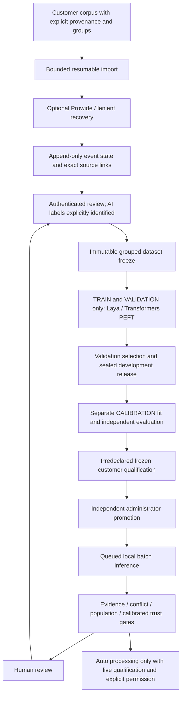

# Client ISO 15022 learning platform: implementation and readiness

Updated: 2026-10-19. Target agreed with the user: **single-tenant Docker on the client's Linux server**, potentially AWS. Qualification evidence in this phase uses **AI-authored/control data**, not customer expert labels. Model performance was measured on the development Mac, not EC2.

## Decision

The repository now contains a separate customer deployment and qualification path. It is a **release candidate for controlled client installation/acceptance**, not an approved unattended production classifier. Do not promise that uploading an arbitrary corpus will produce high accuracy or a very low review rate.

The remaining sign-off dependencies are concrete:

1. Qualify the exact Linux architecture, memory/GPU, Laya checkpoint and selected pretrained LLM on the customer's hardware. Mac training/inference qualification and Linux container-service qualification are separate. A production CUDA image/checkpoint has not been qualified or delivered as a supported profile.
2. Fit and independently validate correctness calibration on representative client data. Actual model calibration is now implemented and evaluated on the controlled AI cohort, with numerical confidence only in supported strata. It does not transfer to a new customer's population. No threshold met the controlled study's predeclared 98% precision lower-bound requirement.
3. Measure the predeclared accuracy/critical-recall/review-rate policy on independent expert-labelled client data. AI labels can qualify software mechanics but cannot unlock customer automation.
4. Agree the client's ISO message/profile coverage, operational capacity, monitoring, recovery objectives, identity administration and security acceptance. Prowide Core parse success is not complete SWIFT standards/business validation.

These are not concealed behind the historical 57-case challenge or the 7,683 unlabelled public excerpts. There is currently no passed customer qualification and automation remains disabled.

The [frozen-checkpoint learning evaluation](FROZEN_CHECKPOINT_LEARNING_EVALUATION.md)
records the larger engineering study: 232 TRAIN notices including TRAIN-only
replay, 600 validation, 800 calibration and 400 protected test notices. The
selected Laya scored 3,591/3,600 factorised test assertions, 391/400 nine-field
exact matches and 324/400 final statuses. All positive restrictions were found
in this restricted cohort. The unchanged challenge scored 70/95 supplied
assertions, demonstrating that the constructed-data gain does not establish
broad language generalisation. No test-trained checkpoint or test calibrator is
part of the product delivery. The linked report records the real application,
continued-learning and persistence checks separately from those quality metrics.

## Implemented architecture

Laya-only, Qwen-only and Laya→Qwen remain configurable candidates. Selection follows validation evidence rather than assuming a cascade wins. Existing research APIs, historical results and original source corpora were preserved. The production service does not mount the research/debug routes.

## Engineering gaps addressed

| Area | Implemented behavior | Verification |
|---|---|---|
| Customer boundary | Named scrypt-hashed identities; ADMIN/TRAINER/REVIEWER/AUDITOR roles; strict host/origin checks; bounded request bodies; no browser-stored credentials | Role/spoofing/CSRF/size tests; real authenticated container requests |
| Deployment | Pinned CPU Linux image, JVM/Prowide, non-root UID 10001, read-only root, dropped capabilities, TLS proxy, isolated API/model network | Actual Docker build and Compose HTTPS/egress tests |
| Corpus import | Raw strings preserved; explicit metadata, source and partition meaning; per-row resumable receipts; collision protection | Unicode/CRLF, malformed row, idempotency and persistence tests |
| Human/AI provenance | Authenticated author/role determines human origin; separate AI-label endpoint; revisions never silently replace labels | AI cannot attest expertise; forged identities and stale edits rejected |
| Blind review | CALIBRATION/FROZEN_TEST HTTP views hide predictions and prior labels; evaluation time is explicit | Protected-source/revision tests |
| Dataset isolation | Every declared member must have a current review; physical per-role keys; connected family/group/lexical-duplicate units | Freeze, lexical isolation, immutable label/source tests |
| Customer training | New development orchestrator reuses actual registered trainers and stops at validation/sealing | Regression proves no calibration/frozen answers are opened by development campaigns |
| Blind scoring | Frozen input-only loader; no general event-detail/review loader in prediction generation; full raw traces fsynced before keys | SQL authorizer rejects any review access before durable predictions |
| Confidence | Portable model/population-bound JSON logistic calibrators, disjoint fit/evaluation groups, predicate and separate final-decision models, Brier/ECE/coverage diagnostics | Known-frequency AI software fixture; reload/tamper/OOD/population tests |
| Customer quality gates | Predeclared threshold, group support, complete-output precision and critical-positive recall lower bounds, review-rate acceptance condition | Small/perfect/duplicate-heavy samples rejected; mathematical sufficient-support fixture passes |
| Protected test discipline | One qualification reservation per frozen dataset; policy/model/calibrator/source hashes pinned in immutable DB/file plans | Reuse/tamper rejection tests |
| Production permission | Requires expert/client-source qualification, independent promotion, unexpired certificate, explicit deployment flag and per-event evidence/trust | AI qualification cannot promote; disabled defaults preserved |
| Feedback circuit breaker | Human-verified errors on auto-processed results suspend the qualification; commit rechecks current source/permission | Worker/feedback tests; original model result retained |
| Durable execution | Explicit tasks; persisted partial results; interruption rather than silent retry; cooperative stop | Queue tests and container restart persistence |
| Resource safety | Cross-container flock, inherited training-child ownership, narrowly scoped stale managed-lease recovery; memory/backend admission | Ownership/recovery and underpowered/unsupported-runtime tests |
| Operations | Readiness includes a measured worker heartbeat in Docker; health/source-free liveness; hash-chained audit; backup/restore | Heartbeat stale-state tests, real Linux cold restore and audit check |
| Customer console | Import, source/blind review, AI labelling, dataset freeze, training, confidence/qualification, saved decision trace and review queue | Actual Playwright workflow, escaped untrusted text and refresh persistence |

## Actual validation evidence

Final ordinary suite: **2,220 tests passed**, one opt-in CPU smoke skipped, 161 model/browser tests deselected. Browser suite: **28 passed**. Separate real registered-model integration: **2 passed**, 64.65 seconds, using the existing real trained Laya and Qwen MLX artifacts on the Mac. No historical semantic assertion was weakened or edited.

Receipts/logs:

- `artifacts/client-production-regression-final.log`
- `artifacts/client-production-all-browser-final.log`
- `artifacts/client-production-real-models.log`
- `artifacts/client-challenge-integrity.json`
- `artifacts/client-linux-build-final.log`
- `artifacts/client-compose-tls-v7/receipt.json`
- `artifacts/client-container-service-v1/receipt.json`
- `artifacts/client-linux-parser.json`
- `artifacts/client-linux-mechanics-v3.json`
- `artifacts/client-linux-restore.json`

The frozen 57-case challenge is byte-identical to Git: SHA256 `0e2f5d991a33deed25f8e9a33682185071c5ff35afd2df9179c1f8565dd17649`. It was not used to tune this engineering phase. Historical 92/95 Qwen authored assertions remain a historical benchmark, not customer accuracy or a result newly established here.

### What Linux model checks actually proved

Real Docker execution used Linux ARM64, PyTorch **2.14.1+cpu**, Transformers **5.20.0**, PEFT **0.21.2**, official Laya SDK **0.4.8**, Java/Prowide and no model network access.

- Real Prowide/JVM parsing, partial recovery and ordinary-notice bypass passed.
- Official base-Laya CPU inference produced all nine native decisions.
- A small **random-initialised Qwen3_5 text architecture** completed two actual PEFT optimizer steps, changed LoRA B weights, saved/reloaded with parity and executed generation. This is software/optimizer verification, not pretrained Qwen3.8 semantic quality or 27B/CUDA compatibility. The controlled input cohort had eight TRAIN/four VALIDATION examples, all AI-authored.
- Full Laya training at 512 and 2048 context settings exited 137 under the 3 GB container cap; no accepted checkpoint was created. Both attempts are recorded INTERRUPTED and retained in their isolated volumes.
- A separate real fine-tuned Laya CPU load/inference attempt also exceeded the cap; Docker's OOM event was captured. It is **not** counted as a passed Linux trained-model deployment.
- A separate 12 GB local VM was attempted without changing the existing Docker context, but its image download timed out. No VM is running. The Colima/Lima tools were installed; the existing Docker Desktop environment was not restarted or resized.
- The service now rejects underpowered training/serving profiles before external task execution, and rejects Mac MLX artifacts as Linux serving artifacts. Conservative memory floors are not measured capacity guarantees.

The final CPU image is an engineering deployment profile. **Exact pretrained Qwen/GLM Linux training and serving, production GPU support, AMD64 execution and sustained customer-scale throughput still require installation qualification.** Do not substitute the random small-model test for those checks.

### Confidence verification, carefully separated

The AI software fixture fits ten correctness models (nine predicates and final status), each with 500 FIT and 200 independently grouped EVALUATION observations. The known-frequency final-decision fixture measured Brier **0.200775** and ECE **0.027840**, with identical JSON reload. This demonstrates calibration machinery only. It is named `SOFTWARE_FIXTURE_NOT_A_MODEL_RELEASE` and is not attached to a real release.

Actual real-model calibration remains insufficient; no customer correctness probability or low review fraction is established. The statistical policy can reject a requested review rate rather than forcing confident decisions. Default acceptance conditions include 500 test groups, 300 accepted groups, 300 positive groups per critical predicate, 98% lower-bound precision/recall and at most 10% review. These are configurable engineering/business assumptions, not legal or regulatory requirements. Exact cluster-level bounds assume the declared groups are independent; clustering cannot prove representativeness or independence.

## Remaining installation and customer acceptance work

| Gate | Current state | Required evidence |
|---|---|---|
| Exact client Linux CPU/GPU/checkpoint | NOT QUALIFIED | Real train/save/reload/serve, capacity, interruption and sustained-load qualification on the proposed server |
| Actual model calibration | NOT ESTABLISHED | Supported disjoint calibration fitting/evaluation using representative authenticated client reviews |
| Low human-review percentage | UNKNOWN | Fixed-threshold independent frozen measurement meeting the client's accepted risk/coverage policy |
| Real customer classification accuracy | UNKNOWN | Independently expert-labelled representative client test data |
| ISO profile/conformance | SCOPED ADAPTER, NOT FULL NETWORK VALIDATOR | Agree MT564/568 lifecycle, other Category 5 observation coverage, qualifiers, market rules and upstream validation assumptions |
| Customer operational/security acceptance | PENDING | Customer identity administration, TLS/secret handling, monitoring, storage/retention, recovery targets, load limits and security assessment |

Model/source/prompt/calibrator changes require new qualification. Operational source/permission checks occur again at result commit; unresolved or unsupported cases remain in review. There is no promise that Laya-first or Qwen-first will achieve a commercially useful coverage rate on unseen customer notices.

## Next engineering/acceptance step

Obtain the proposed Linux server/GPU specifications and a small representative client message/profile sample. Run an installation qualification using the exact supported checkpoint and agreed context/batch sizes, then collect independent client labels through the authenticated review workflow. Freeze the qualification policy before opening the held-out customer test. This will resolve the most consequential remaining gaps without inflating synthetic results.

Runbook: [Client Linux deployment](../../docs/CLIENT_LINUX_DEPLOYMENT.md). Initial gap plan: [CLIENT_PRODUCTION_GAP_PLAN.md](CLIENT_PRODUCTION_GAP_PLAN.md). Earlier actual-learning evidence: [ISO15022_TRAINABLE_RELEASE_VERIFICATION.md](ISO15022_TRAINABLE_RELEASE_VERIFICATION.md).

Technical sources checked on 2026-10-18: [Docker service/secret controls](https://docs.docker.com/reference/compose-file/services/), [Compose secret limitations](https://docs.docker.com/reference/compose-file/secrets/), [PyTorch CPU/CUDA installation distinction](https://pytorch.org/get-started/locally/), [PEFT base/adapter checkpoint contract](https://huggingface.co/docs/peft/developer_guides/checkpoint), [Laya publisher model card and Apache-2.0 metadata](https://huggingface.co/convaiinnovations/laya). Model weights are not bundled; retain the exact selected checkpoint's licence/provenance at customer installation.
