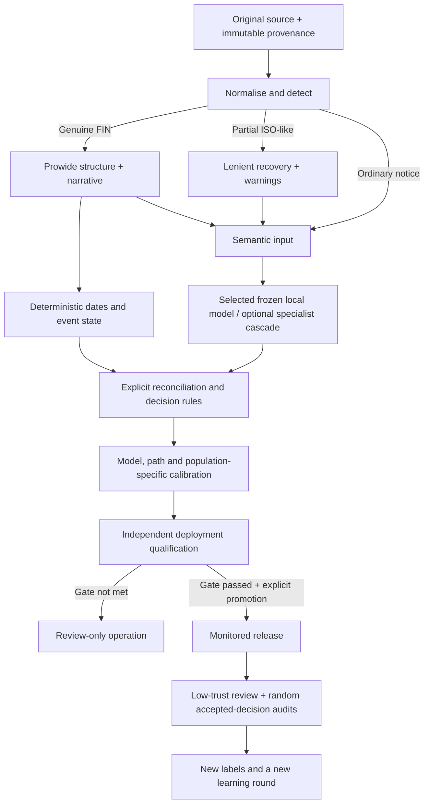

# Voting Intelligence Framework — production readiness evaluation

23 October 2026. **Engineering work delivered; neural qualification incomplete.
No production-automation certificate and no customer-accuracy claim.**

## Decision

The framework now has stronger evidence handling, complete-output model
selection, derived-input leakage protection, explicit model/label provenance,
and an indexed-evidence Qwen interface shared by serving and both LLM trainers.
The current source passes 2,351 ordinary tests and 35 browser tests. The Linux
service acceptance probe passes, including authentication, restricted container
execution and restart persistence. It does not execute Linux neural models.

The new indexed Qwen condition has **not** completed confidence calibration or
independent frozen qualification. The Mac repeatedly entered deep-idle sleep,
including power-log events labelled `Dark Wake Thermal Emergency`. Read-only
hardware inspection reported a closed lid. The paired qualification was stopped
with SIGINT after six pilot requests, and its model processes exited. Its partial
predictions and interruption receipt remain intact. No automation was enabled.
This report does not call the overall production-readiness objective complete.

A separate retry, `production-qualification-indexed-20261023-awake2`, is being
supervised with a job-scoped AC idle-sleep assertion. It leaves global/display
settings alone and stops automatically if suspension recurs or the six-hour
budget expires. Its manifests and outputs are separate; it does not resume or
overwrite the interrupted attempt. Final calibration/test claims await its
completed receipts.

## Architecture and qualification boundary

Customer workflow: frozen foundation → TRAIN updates → VALIDATION selection →
model/criteria freeze → separate calibration → independent qualification →
explicit promotion → monitored release. UNKNOWN facts and unsupported confidence
remain review outcomes. Neither model self-assessment nor native choice scores
are presented as calibrated correctness probabilities.

## Evidence and selection fixes

- The residual OTHER restriction reducer no longer treats a waiver of a named
  requirement, such as POA or recall, as a waiver of unrelated eligibility terms.
  Distinct residency/investor-class conditions retain their individual scope.
- Whole-document passage verification preserves the document label and exposes
  real disagreement, supersession, unresolved routes and contradictory passages.
  Missing support cannot become an invented quote.
- Voting-conflict matching no longer interprets “not a voting prerequisite” or
  “no voting restriction” as denial of voting. Tests also protect double negation
  such as “No ballot will be rejected…”. Genuine denials still trigger review.
- The cheap locator recognises ordinary negative formulations, including
  “unnecessary”; merely mentioning a topic does not establish a requirement.
- Customer model selection now evaluates complete outputs where fully labelled:
  nine factors, deadline and final status. Semantic-only selection is explicitly
  labelled when decision truth is incomplete. Critical-positive guards remain.
- Release scope is unqualified rather than falsely hard-coded as AI-only for
  every customer. Model origins and lineage are explicit. New training manifests
  separate TRAIN/VALIDATION record origins from development-bundle totals.
- Qualification reports include a truth-derived minimum review fraction. No
  threshold can resolve information that the notice genuinely leaves UNKNOWN.

These changes alter evidence/routing/rule behaviour, not historical predictions.
The 57-case challenge and its expected assertions were unchanged.

## Laya findings

The frozen parent remains the selected specialist. Its original 374-notice
validation contains 3,327/3,366 correct semantic fields. Evidence fixes improve
final-status agreement from 290/374 to **363/374** without changing those weights
or field predictions. The faster locator obtains 366/374 on that family but
generalises worse than native passage support to the fresh family.

On the independently authored **development validation family**, the parent has
1,276/1,440 fields correct and 73/160 complete nine-field matches. Correcting the
voting guard changes final-status agreement from 51/160 to **97/160**. This remains
inadequate as a general-purpose low-review specialist. Software bugs accounted
for part of the problem; they were not the whole problem.

An evidence-matched head-training attempt added 589 unique annotated passage
questions to the original 836 TRAIN notices: 14,744 effective question items per
epoch, two epochs, fixed parent and private SDK working copy. It did not improve
fresh validation (1,272/1,440 versus 1,276/1,440).

The subsequent derived-input audit found **nine projected quotations matching
complete original validation inputs**. No protected/challenge input collisions
were detected by that audit. The attempt is **QUARANTINED**, not a new foundation;
registered serving/export refuses it. It was not run on the challenge or
promoted. Future evidence augmentation checks derived inputs against validation
and protected fingerprints **before optimiser updates**. A TRAIN-only parent is
insufficient protection when its extracted sentence is itself a held-out notice.

The original parent and historical studies remain unchanged. Shared linguistic
atoms in controlled synthetic data are not evidence of broad independent
linguistic generalisation.

## Paired local Qwen pilot

The 20 development notices were selected by source hash before Qwen execution;
all 20 source hashes are unique. **All 20 are votable**, so this pilot provides no
negative-votability test. They are AI-authored controlled notices, not customer
data. These numbers must not be presented as production accuracy.

| Same 20 notices | Correct semantic assertions / 180 | Complete nine-field matches |
|---|---:|---:|
| Frozen Laya parent | 162 | 7 |
| Base Qwen, full JSON/evidence text | 180 | 20 |
| Base Qwen, indexed evidence | 180 | 20 |

The Laya complete-match count is stored in `PAIRED_LAYA_20.json`; consult that
artifact rather than inferring it from field accuracy. Qwen positive support is
only 20 votability, 4 blocking, 6 POA, 4 registration, 4 disclosure, 5 holding,
4 split, 6 recall and 5 other-restriction assertions. Both Qwen conditions recover
all of these positives; these small supports establish no high-reliability bound.

Both Qwen conditions agree with 16/20 published final statuses under the current
conservative conflict rule. The other four contain genuinely UNKNOWN restriction
facts, correctly identified by Qwen. Their ambiguity notes trigger review before
the final-status rule that generated the synthetic expected status. They are
therefore a distinction between semantic correctness, derived status and review
clearance—not four missed semantic facts. The expected answers were not changed.

| Recorded request time, seconds | Full JSON | Indexed evidence |
|---|---:|---:|
| Median | 34.01 | 13.84 |
| Mean | 33.83 | 14.11 |
| Minimum | 29.36 | 12.73 |
| p95 | 36.79 | 16.27 |
| Maximum | 40.85 | 16.91 |

Indexed generation averages 146.4 output tokens. These are recorded active
request timings on the development Mac, with cold lazy loads where recorded.
Sleep/thermal interruptions prevent interpreting them as deployment throughput
or an uninterrupted sustained-load qualification. No EC2 timing is claimed.

## Indexed evidence implementation and qualification

`training/framework/semantic_io.py` provides two versioned interfaces:
`FULL_JSON` (unchanged default) and `INDEXED_EVIDENCE` (explicit opt-in).
Both expand into the same nine-field business schema. Indexed output contains
factor values and source-passage IDs. The application resolves IDs to exact
original substrings, validates ranges and rejects invalid/duplicate IDs. It does
not manufacture quotations or class probabilities.

The first private compact pilot incorrectly treated complete Markdown JSON
fences as schema failures. The normalised replay applies exactly the existing
full-adapter fence handling: 12 wrappers normalised, no model output altered,
zero remaining schema failures, 180/180 semantic assertions. The original failed
parser receipt is retained. Production uses the same normalisation and has
regression coverage; arbitrary surrounding text is not accepted.

The actual registered indexed adapter completed six valid pilot requests before
host interruption. Expanded canonical results and exact quotations were checked.
The code preserves raw wire output, canonical parsed fields, wire-format identity,
schema handling and evidence. Optional bounded repair remains review-only.

The exact local Qwen MLX model also completed **two actual LoRA optimiser updates**
on a separate 8-TRAIN/4-VALIDATION AI-authored format fixture. Weights changed;
checkpoint reload maximum logit difference was **0.0**; elapsed training/reload
time was 188.12 seconds; peak MLX allocation was approximately 19.78 GB. This
qualifies training/format/reload mechanics, **not domain-model quality**. The
resulting test adapter is not selected or shipped. Both MLX and Transformers
trainers use the same indexed supervised-target transformation. Frozen seeds
bind the output format; customer continuation cannot silently change it.

Foundation: `mlx-community/Qwen3.8-27B-4bit`, revision
`10c35caafbb80f7dc6a7a432cdd11af10a6d4818`, direct mode. No additional model was
downloaded. The official Qwen4 catalogue query returned no candidates in the
recorded research; Qwen4 was not substituted or tested.

## Confidence and qualification status

The framework's calibration, independent support checks, identity/population
binding, threshold selection, independent qualification and promotion controls
are implemented. Previous specialist-only calibrations are not transferred to
the new Qwen protocol or an altered hybrid release.

**New indexed-Qwen calibration: NOT COMPLETED.**

**New hybrid final-output calibration: NOT COMPLETED.**

**Supported automation operating point for these releases: NONE.**

**Current numerical confidence: null / heuristic until the relevant calibration
passes. Automation remains false.**

The frozen paired qualification plan pins both actual registered releases and
their sources. One real independent Qwen stage would be shared across paired
architectures, with hashes and matching input/context checks; hybrid downstream
replay is explicitly labelled and cannot be advertised as measured end-to-end
hybrid latency. The run did not reach calibration or independent test scoring.

The replacement independent holdout contains 371 unique source texts / 355
lexical groups in a separately authored fourth linguistic column. Its answer
file has not been opened by the qualification run. The earlier 240-case set was
opened before an interruption reached the process; that stop-receipt error is
explicitly corrected and the set is now diagnostic only.

## Verification and distribution

- **2,351 ordinary tests passed**, one optional test skipped, 168 opt-ins
  deselected. The current GPU worker suite was not completed after interruption.
- **35 browser tests passed.** A real async-refresh bug found during verification
  could close a learning form while an operator opened or edited it. The form
  now invalidates the pending replacement; a delayed-refresh regression verifies
  the draft survives. The failed 32/34 browser attempt is retained.
- Linux ARM64 image acceptance passed named authentication, non-root/read-only
  execution, dropped capabilities, source import and restart persistence.
  This is service acceptance, **not Linux neural training/inference qualification**.
- Dependency audit: 58 Python dependencies checked, none skipped, no known
  vulnerabilities reported. This is not an OS/JVM security certification.
- Installation model probe executes/reloads all configured stages, validates
  exact evidence and returns a failing status if a configured model was never
  exercised. Linux admission refuses unsupported MLX artifacts or insufficient
  capacity rather than treating a service health check as neural readiness.
- Qualification corpora, private generators, test-trained adapters, calibrators,
  model weights, databases and secrets remain outside the shipped product.
  Small regression fixtures and input-only exclusion fingerprints remain part
  of test/leakage protection. `AUTOMATION_ENABLED=false` is unchanged.

## Remaining gates and the next execution

1. Keep the development Mac open/awake in conditions suitable for uninterrupted
   local model execution. Do not override thermal protections. Start a **new**
   attempt; never overwrite/restart the interrupted run under its original ID.
2. Complete registered Qwen/hybrid calibration on disjoint calibration folds,
   validation-only operating-point selection and the 371-record independent
   holdout. Report per-field support/F1/critical recall, confidence availability,
   Brier/ECE, accepted errors, review floor and actual coverage. Any failed gate
   remains failed; additional calibration support may be required.
3. Run the frozen 57-case challenge separately, real customer-worker integration,
   direct hybrid replay-parity/latency checks and sustained throughput tests on
   an awake host. Do not call partial assertions customer accuracy.
4. Qualify the client's exact Linux model/runtime/hardware. Mac MLX artifacts are
   not Linux CUDA checkpoints. Provision suitable resources and run the shipped
   installation probe plus a genuine customer learning campaign there.
5. Collect representative independently expert-labelled client notices before
   any customer automation promotion. AI-authored data qualifies framework
   mechanics and declared synthetic populations; it cannot establish customer
   accuracy, a guaranteed small review rate, or 100% future correctness.

The recommended candidate is the frozen base Qwen with indexed evidence and
deterministic rules, pending the outstanding gates. Laya remains an optional
customer-trained specialist whose actual coverage must earn its place. More
layers or more epochs are not automatically justified by the current evidence.
